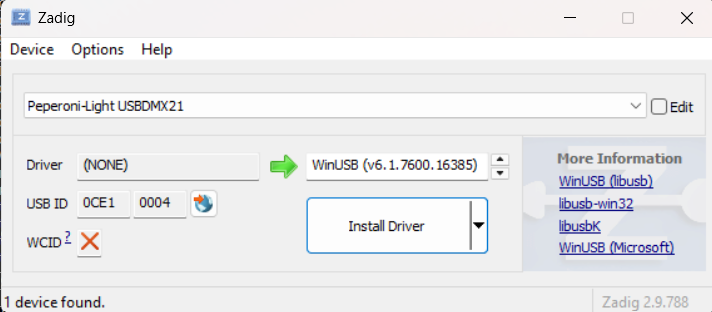

Introduzione
--------------

Il plugin di output Peperoni supporta i dispositivi di output USB-DMX prodotti da [Peperoni Light](http://www.peperoni-light.de/products1.htm).

Requisiti
--------------

### Linux

Su tutte le distribuzioni Linux, dovete installare libusb. Se installate QLC+ con l'Ubuntu Software Center o un altro strumento di installazione automatica, questa libreria verrà installata automaticamente per voi.

### Mac OS X

Non è necessario nulla di speciale per Mac OS X. Tutti i componenti richiesti sono già inclusi nel pacchetto dell'applicazione Q Light Controller Plus poiché QLC+ utilizza l'interfaccia USB nativa di OS X.

### Windows

QLC+ comunica con i dispositivi Peperoni tramite libusb, che è inclusa nell'installer di QLC+, quindi non è necessaria alcuna DLL aggiuntiva. Il dispositivo deve utilizzare il driver **WinUSB**:

* I dispositivi con firmware 0x1000 o successivo installano automaticamente il driver WinUSB quando vengono collegati.
* I dispositivi con firmware precedente richiedono l'installazione manuale del driver WinUSB con [Zadig](https://zadig.akeo.ie): aprite Zadig, selezionate **Options > List All Devices**, scegliete il dispositivo Peperoni, selezionate **WinUSB** e cliccate **Install Driver**. In alternativa, aggiornate il firmware del dispositivo.
* Per l'X-Switch, selezionate **libusbK** invece di WinUSB in Zadig, poiché WinUSB non può cambiare la configurazione USB del dispositivo.

