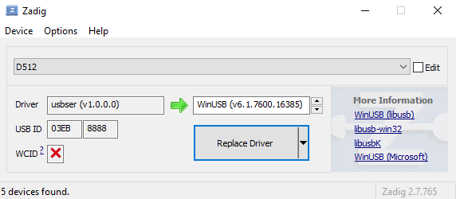

Introduction
------------

Le plugin de sortie uDMX prend en charge l'interface USB-DMX [Anyma uDMX](https://www.anyma.ch/research/udmx/) sur Linux, macOS et Windows.

Prérequis
------------

### Linux

Sur toutes les distributions Linux, vous devez installer libusb. Si vous installez QLC+ avec le Ubuntu Software Center ou un autre outil d'installation automatique, cette bibliothèque sera installée automatiquement pour vous.

### macOS

Sur Apple macOS, vous n'avez besoin d'aucun driver puisque QLC+ utilise l'interface USB native de macOS.

### Windows

QLC+ communique avec les périphériques uDMX via libusb, qui est inclus dans l'installeur de QLC+ : aucune DLL supplémentaire n'est donc nécessaire. Le périphérique doit utiliser le driver **WinUSB**, qui peut être installé avec [Zadig](https://zadig.akeo.ie) : ouvrez Zadig, sélectionnez **Options > List All Devices**, choisissez le périphérique uDMX, sélectionnez **WinUSB** et cliquez sur **Install Driver**.

Réglage fin
------

Il est possible de modifier la fréquence de trame DMX pour tous les périphériques uDMX grâce à une clé de réglage cachée sur chaque plateforme. Cette clé indique à QLC+ combien de fois chaque trame DMX (512 canaux) doit être envoyée à l'univers par seconde. Une valeur de « 30 » signifie 30 fois par seconde (30Hz). Veuillez vous référer à la section uDMX des [Réglages manuels des paramètres](/advanced/parameters-tuning#3-udmx-frequency)
